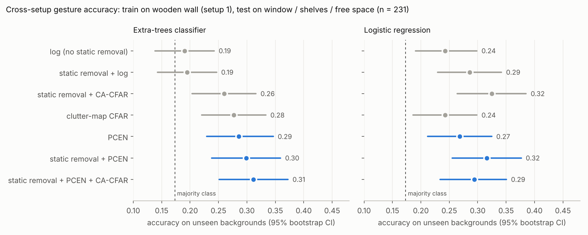
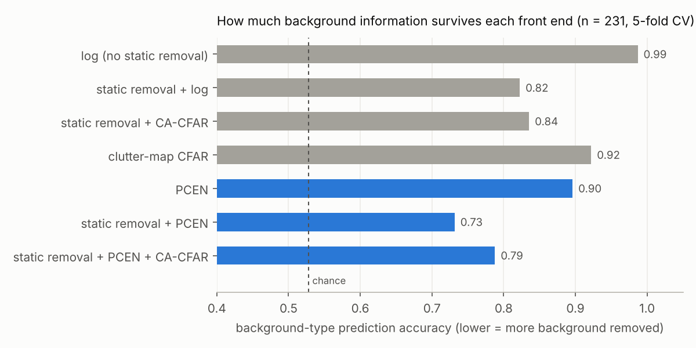

# PCEN vs. CFAR on the KIT FC-FMCW gesture data set: results

**Data:** KIT "Flexible Data Set for Radar-based Gesture Recognition with an FC-FMCW Radar" (Antes et al., 2024, doi:10.35097/hCNNxXlJBdFTSYse, CC BY 4.0).
- Sensor: Infineon BGT60TR13C, raw IF, 3 Rx, 57.5–64.5 GHz.
- Each recording: 31–36 frames × 600 chirps × 128 samples, a near-continuous chirp stream of about 6 s.

**Sample used:** 681 recordings, selected with a fixed seed (`selection.json`).

| Set | Recordings | Content |
|---|---:|---|
| Part 2, setup 1 (wooden wall) | 240 | 40 per class: gestures 0–4 and *n* (no gesture) |
| Part 2, setups 4–7 | 231 | all of them: window, shelves, free space |
| Part 1, setups 3v1 / 3v2 | 210 | 105 gestures recorded at the same time by a sensor at 0° and one at 40°, 7 classes |

Legend duplicates (942, 955, 1429) and the 7 empty files were excluded.

**Pipeline:**
1. Treat each recording as one chirp stream and cut it into sliding windows of 128 chirps with a hop of 64 chirps (about 52 time steps per second).
2. Build a range-Doppler map per window.
3. Reduce to two maps over time: micro-Doppler (summed over the 0.15–0.75 m hand range) and range-time.
4. Keep each map with and without static removal.

Code: `pcen_radar/kit.py` and `scripts/kit_experiments.py`.

All front ends, parameters, features, classifiers and metrics were fixed before any result was seen. They are listed in the header of `scripts/kit_experiments.py`. In brief:
- **PCEN:** time constant τ = 1 s, α = 0.98, δ = 2, r = 0.5.
- **CA-CFAR:** guard 2×2, training 8×4.
- **Features:** 256 per recording; for each pooled channel, the mean, standard deviation, maximum and 90th percentile over time, so the features don't depend on when the gesture happens.
- **Classifiers:** standardised logistic regression (LR) and extra-trees (ET, 500 trees).

---

## Main result: cross-setup generalisation (E2)

Train on setup 1 (wooden wall), test on the 231 recordings with unseen backgrounds. Six classes; always guessing the most common class scores 0.17.

| Front end | ET accuracy [95% CI] | LR accuracy [95% CI] |
|---|---|---|
| log (no static removal) | 0.19 [0.14, 0.24] | 0.24 [0.19, 0.30] |
| static removal + log | 0.19 [0.14, 0.25] | 0.29 [0.23, 0.34] |
| static removal + CA-CFAR | 0.26 [0.20, 0.32] | **0.32** [0.26, 0.39] |
| clutter-map CFAR | 0.28 [0.22, 0.33] | 0.24 [0.19, 0.30] |
| PCEN | 0.29 [0.23, 0.35] | 0.27 [0.21, 0.32] |
| static removal + PCEN | 0.30 [0.24, 0.36] | **0.32** [0.26, 0.38] |
| static removal + PCEN + CA-CFAR | **0.31** [0.25, 0.37] | 0.29 [0.23, 0.35] |

Paired bootstrap of the accuracy difference against static removal + log (2000 resamples, not corrected for multiple comparisons):

| Comparison | ET | LR |
|---|---|---|
| static removal + PCEN − static removal + log | **+0.10 [+0.06, +0.16]** | +0.03 [−0.04, +0.10] |
| static removal + PCEN + CA-CFAR − static removal + log | **+0.12 [+0.07, +0.17]** | +0.01 [−0.06, +0.07] |
| static removal + CA-CFAR − static removal + log | +0.07 [+0.02, +0.11] | +0.04 [−0.03, +0.11] |
| clutter-map CFAR − static removal + log | +0.08 [+0.03, +0.14] | −0.04 [−0.11, +0.03] |

Against log without static removal, static removal + PCEN is significantly better with both classifiers: ET +0.11 [+0.05, +0.17], LR +0.07 [+0.01, +0.14].

**Within setup (E1):** 5-fold CV on setup 1. Every front end scores 0.86–0.94. Log without static removal is best (LR 0.91, ET 0.94); the PCEN variants score 0.86–0.91.

## Background suppression measured directly (E4)

How well can the *background type* (window, shelves, free space) be predicted from each front end's features? Same 231 recordings, LR, 5-fold CV. Chance is 0.53, and lower means more background removed.

| Front end | Background predicted correctly |
|---|---|
| log (no static removal) | 0.99 |
| clutter-map CFAR | 0.92 |
| PCEN | 0.90 |
| static removal + CA-CFAR | 0.84 |
| static removal + log | 0.82 |
| static removal + PCEN + CA-CFAR | 0.79 |
| **static removal + PCEN** | **0.73** |

## Other pre-registered tests

**Cross-angle (E3):** train on the 0° sensor and test on the 40° sensor, then the reverse; the table gives the mean of both. Seven classes; chance is about 0.14.

| Front end | LR | ET |
|---|---|---|
| log (no static removal) | 0.30 | 0.37 |
| static removal + log | 0.30 | 0.35 |
| static removal + CA-CFAR | 0.33 | 0.31 |
| clutter-map CFAR | 0.32 | 0.31 |
| PCEN | 0.31 | 0.31 |
| static removal + PCEN | 0.37 | 0.36 |
| static removal + PCEN + CA-CFAR | **0.39** | **0.39** |

There are no confidence intervals here, and the differences are within noise.

**Gesture vs. no gesture without training (E5):** this test failed for every method, with AUC 0.37–0.42, i.e. below 0.5. The no-gesture class contains *random movement* with more motion energy than the gestures, so a motion-energy score ranks it higher. The test design was invalid for this data and gives no information about the front ends.

## Robustness and diagnostics (post hoc, not used to pick methods)

**PCEN time constant:** static removal + PCEN with τ = 0.25 / 0.5 / 1 / 2 / 4 s.
- Cross-setup accuracy (ET): 0.23 / 0.25 / **0.30** / 0.31 / 0.33.
- Background prediction: 0.79 / 0.77 / **0.73** / 0.74 / 0.74.

Longer time constants are slightly better. The pre-registered value of 1 s was not the best one, so the result was not picked by tuning.

**Hand distance does not explain the cross-setup gap.** Accuracy is near chance both for test recordings where the hand is at 0.3 m (as in training, 177 recordings) and at 0.5 m (54 recordings).

**Per-class recall (ET):** with static removal + PCEN, recall improves for "button press" (0.25 → 0.42), "come here" (0.20 → 0.47) and "fingers to thumb" (0.00 → 0.20), compared with log.

---

## Interpretation

1. **PCEN removes background information most effectively.** Static removal + PCEN leaves the least information about the background (0.73, against 0.82 for static removal + log and 0.84 for static removal + CA-CFAR). This is the most direct evidence for the paper's claim.
2. **That translates into a modest, real gain across backgrounds, but not a solution.**
   - With the tree classifier, the PCEN variants beat both log baselines by +0.10 to +0.12, and the confidence intervals exclude zero.
   - With logistic regression, PCEN only beats log without static removal; static removal + CA-CFAR does as well as PCEN.
   - Every method stays far below within-setup accuracy (about 0.3 against 0.9). The shift between setups 1 and 4–7 is dominated by something PCEN does not address: different sessions and people, and how the gestures were performed.
3. **Without static removal, PCEN behaves like clutter-map CFAR** (ET 0.29 vs 0.28; background prediction 0.90 vs 0.92). The simulation showed the same. The benefit comes from combining PCEN with static removal, not from replacing it.
4. **Within one setup, PCEN costs a little accuracy** (0.86–0.91 against 0.91–0.94 for log). It discards background cues that happen to be useful when train and test share a room. That is the expected trade-off of a background-invariant front end.

## Caveats (state these in a paper)

- **Setups are confounded with session and person.** Setups 4–7 were recorded on other days, and setup 5 includes a second participant. Testing on unseen backgrounds is not a pure change of background.
- **No participant IDs.** The filenames carry none, so a test on held-out people is not possible.
- **Multiple comparisons.** The confidence intervals above are not corrected for 12 comparisons per classifier. Two-sided bootstrap p-values (20,000 resamples) with a Bonferroni correction (×12):
  - **Survive (ET):** static removal + PCEN − static removal + log, p < 0.0001; static removal + PCEN + CA-CFAR − static removal + log, p < 0.0001; static removal + PCEN − log without static removal, p = 0.0005.
  - **Do not survive:** ET static removal + CA-CFAR − static removal + log (p = 0.005); ET clutter-map CFAR − static removal + log (p = 0.007); LR static removal + PCEN − log without static removal (p = 0.027); LR static removal + CA-CFAR − log without static removal (p = 0.014).
  - With the tree classifier, only the PCEN gains are robust to correction.
- **One extra recording.** The 0° sensor set has one recording more than the 40° set (106 vs 105), because a recording used for pipeline testing was left in.
- **The detection test (E5) failed** and should be redesigned: score only part 2's no-movement recordings, or use the pre-gesture segments as negatives.

---

## CNN with learnable PCEN (run on GPU, `scripts/kit_train_cnn.py`)

Setup: the same small CNN behind each front end. The input is micro-Doppler plus range-time, 128 channels × 256 time steps. Training: 40 epochs with no early stopping, train on setup 1 and test on setups 4–7 (231 recordings). Everything was fixed before the run, as listed in the script header.

**Cross-setup, 10 seeds** (always guessing the most common class scores 0.17):

| Front end | Accuracy mean ± sd |
|---|---|
| log (no static removal) | 0.27 ± 0.04 |
| static removal + log | 0.42 ± 0.08 |
| static removal + fixed PCEN (τ = 1 s) | 0.37 ± 0.09 |
| **static removal + learnable PCEN** | **0.47 ± 0.06** |
| learnable PCEN (no static removal) | 0.39 ± 0.07 |

Paired by seed (same initialisation and batch order for every front end):

| Comparison | Mean diff | Seeds won | 95% CI | Wilcoxon p |
|---|---|---|---|---|
| learnable PCEN + static removal − static removal + log | +0.05 | 7/10 | [−0.02, +0.12] | 0.30 |
| fixed PCEN + static removal − static removal + log | −0.05 | 4/10 | [−0.14, +0.03] | 0.36 |
| learnable PCEN + static removal − fixed PCEN + static removal | **+0.10** | 8/10 | [+0.04, +0.18] | **0.027** |
| static removal + log − log (no static removal) | **+0.15** | 8/10 | [+0.09, +0.22] | **0.010** |
| learnable PCEN (no static removal) − log (no static removal) | **+0.13** | **10/10** | [+0.07, +0.18] | **0.002** |
| learnable PCEN + static removal − log (no static removal) | **+0.20** | **10/10** | [+0.15, +0.25] | **0.002** |
| learnable PCEN (no static removal) − static removal + log | −0.03 | 4/10 | [−0.10, +0.04] | 0.56 |

**3-seed run over all splits:** within setup (48 test recordings) / cross-setup / cross-angle

| Front end | Within setup | Cross-setup | Cross-angle |
|---|---|---|---|
| log (no static removal) | 0.74 ± 0.09 | 0.25 ± 0.01 | 0.21 ± 0.04 |
| static removal + log | 0.53 ± 0.10 | 0.41 ± 0.06 | 0.26 ± 0.03 |
| static removal + fixed PCEN | 0.65 ± 0.06 | 0.38 ± 0.06 | 0.32 ± 0.07 |
| static removal + learnable PCEN | 0.76 ± 0.04 | 0.43 ± 0.06 | 0.32 ± 0.04 |
| learnable PCEN (no static removal) | 0.70 ± 0.09 | 0.34 ± 0.05 | 0.28 ± 0.07 |

**What PCEN learns.** All parameters start from the fixed values; the table shows the mean over channels and seeds.

| | s → time constant τ | α | δ | r |
|---|---|---|---|---|
| Initial (fixed PCEN) | 0.023 → 1.0 s | 0.98 | 2.0 | 0.50 |
| Learned, cross-setup, with static removal | 0.164 → **0.13 s** | 0.93 | 1.97 | 0.50 |
| Learned, cross-setup, no static removal | 0.171 → **0.13 s** | 0.97 | 1.91 | 0.49 |
| Learned, within setup, with static removal | 0.106 → 0.21 s | 0.94 | 2.00 | 0.50 |
| Learned, cross-angle, with static removal | 0.057 → 0.40 s | 0.95 | 1.96 | 0.52 |

### CNN interpretation

1. **The CNN generalises much better than the shallow models**: 0.47 against 0.31 for the best shallow result.
2. **Learnable PCEN is the best front end on average**, but its lead over static removal + log (+0.05, won on 7/10 seeds) is **not significant** with 10 seeds. Claim "comparable or better", not "better".
3. **Learning matters.** Learnable PCEN beats the same PCEN with fixed parameters (+0.10, p = 0.03). PCEN with the audio-style default τ = 1 s is no better than static removal + log.
4. **Learnable PCEN alone does about what static removal does.** Without static removal, it beats log on all 10 seeds (+0.13) and is statistically indistinguishable from static removal + log. A learnable temporal normaliser recovers the benefit of a hand-designed clutter filter.
5. **Radar wants a much faster PCEN than audio.** Training moves τ from 1 s to about 0.13 s across setups and to 0.2–0.4 s for the other splits, and lowers α slightly (0.98 → 0.93). δ and r barely move. A time constant that short makes PCEN behave close to a temporal high-pass, a "spectral flux" detector (cf. Lostanlen et al. 2019, Prop. 2.1). It tracks the background within a few gesture-cycles rather than over seconds.

### Caveats specific to the CNN results

- **The parameter choices are from this data.** τ ≈ 0.13 s comes from the cross-setup training data. Evaluating a fixed PCEN with τ = 0.13 s on the same test set would leak information. Confirm it on independent data, such as your own BGT60 recordings or a different KIT split.
- **Means hide per-channel spread.** The learned values are averages over 128 channels; individual channels may differ systematically, for example velocity vs. range channels.
- **The within-setup and cross-angle results are noisy.** They use 3 seeds and small test sets of 48 and 105 recordings, and the CNN is likely overfitting there: the tree classifier reached 0.94 within setup.
- **The parameters may not have converged.** 40 epochs is short, and s and α could still be drifting.
